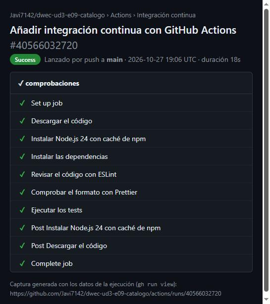
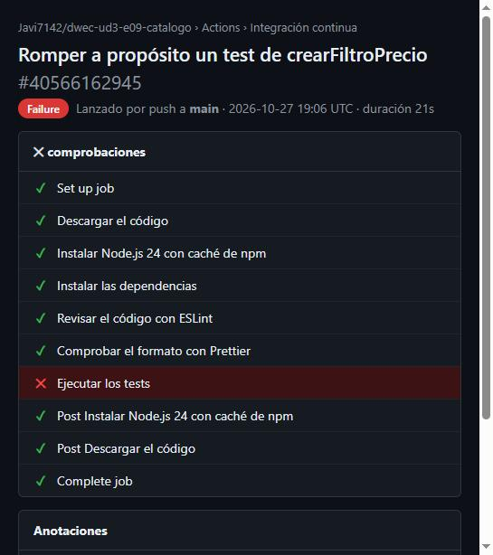

# Catálogo de productos

Repositorio del ejercicio: <https://github.com/Javi7142/dwec-ud3-e09-catalogo> (privado).

## Cómo ejecutarlo

Desde la carpeta del proyecto, en el Dev Container (o en un equipo con Node.js 24):

```bash
npm install            # instala las dependencias (el contenedor ya lo hace al crearse)
npm start              # informe del catálogo (src/main.js)
npm test               # tests con Vitest
npm run lint           # ESLint
npm run format:check   # comprueba el formato con Prettier (npm run format lo corrige)
```

Salida de `npm start`:

```text
🔎 Con stock entre 10 y 30 €: Cien años de soledad, Vinilo Rosalía, Álbum de fotos, Cargador USB
🔎 Ofertas de más de 25 €: Vinilo Rosalía, Órgano infantil, Auriculares
💎 Los 3 más caros: Ebook, Órgano infantil, Ukelele
🔤 Los 5 primeros por nombre: Agenda, Álbum de fotos, Aprende JavaScript, Auriculares, bolígrafos (pack 10)
📦 Resumen por categoría:
   electrónica   3 productos ·  37 uds ·  1210.60 €
   libros        3 productos ·  17 uds ·   398.80 €
   música        3 productos ·  12 uds ·   464.73 €
   papelería     3 productos ·  70 uds ·   537.50 €
🏷️ Etiquetas: clásico, infantil, informática, instrumento, lectura, novela, oferta, oficina, regalo, vinilo
💸 Rebaja del 20 % en ofertas: L02 19.60 · M01 23.99 · M03 47.92 · P02 3.96 · E01 31.96
🗂️ Original intacto: L02 sigue a 24.50 € · primer producto L01
🧮 Código | Nombre | Precio
   P02 | bolígrafos (pack 10) | 4.95
   P03 | Agenda | 12.00
   P01 | Álbum de fotos | 14.50
❌ RangeError: Porcentaje no válido: 150
```

## Operaciones agregadas

Ninguna función tiene `for`, `while` ni `for…of`.

| Función | Tipo | Métodos | Por qué |
|---------|------|---------|---------|
| `filtrarPor` | Filtrado | `filter` + `every` | `filter` se queda con los productos que cumplen la condición, y esa condición es «todos los criterios a la vez», que es justo lo que responde `every` sobre el array de criterios (_rest_). Con cero criterios, `every` da `true` y `filter` devuelve una copia de toda la lista. Con `some` sería «cualquiera» |
| `crearFiltroPrecio` | Ninguna (devuelve un criterio) | Comparaciones `>=` y `<=` dentro de un _closure_ | Es una función de orden superior: devuelve una función que recuerda `minimo` y `maximo`. `>=` y `<=` incluyen los extremos |
| `crearFiltroEtiqueta` | Ninguna (devuelve un criterio) | `includes` dentro de un _closure_ | Para saber si un array contiene un valor basta con `includes`; no hace falta recorrerlo entero con otra cosa |
| `ordenarPor` | Transformación (reordenación) | `toSorted` + `localeCompare` | `toSorted` ordena una copia, así que no cambia la lista recibida (`sort` sí lo haría). `localeCompare` con `'es'` ordena textos con tildes (la `Á` junto a la `A`), y los números se restan. El sentido (`±1`) invierte la comparación sin repetir código |
| `resumenPorCategoria` | Recolección + reducción | `Object.groupBy`, `Object.entries`, `map`, `reduce`, `toSorted` | `groupBy` agrupa por categoría sin tener que crear el objeto y comprobar claves a mano; `reduce` suma unidades y valor de cada grupo; `toSorted` deja las categorías en orden alfabético |
| `etiquetasUnicas` | Transformación (aplanar) + recolección | `flatMap`, `Set`, `toSorted` | `flatMap` junta las etiquetas de todos los productos en un array plano (un `map` daría un array de arrays); el `Set` quita los repetidos; `toSorted` con `localeCompare` ordena |
| `aplicarDescuento` | Transformación | `map` con _spread_ | Hay que devolver un producto por producto y en el mismo orden, que es lo que hace `map`. El _spread_ crea el objeto nuevo en lugar de modificar `producto.precio`. Un `filter` perdería los productos que no se rebajan |
| `tablaPrecios` | Transformación | `map` con desestructuración y _spread_ | Cada producto se transforma en una fila `[codigo, nombre, precio]`; el _spread_ pone la cabecera delante |

## Mutación y copias

**1. Métodos que mutan y los que he elegido.** Los métodos que modifican el array sobre el que se llaman son `sort`, `reverse`, `splice`, `push`, `pop`, `shift`, `unshift`, `fill` y `copyWithin`; asignar a una propiedad (`producto.precio = …`) muta además el objeto. No uso ninguno. En su lugar: `toSorted` (en vez de `sort`) para ordenar una copia, `filter` y `map` (que devuelven arrays nuevos), el operador _spread_ (`{ ...producto, precio }`) para crear objetos nuevos, y `slice` solo en las pruebas. Los tests lo comprueban: `filtrarPor`, `ordenarPor` y `aplicarDescuento` dejan la lista original igual que estaba (con `structuredClone` para comparar antes y después).

**2. La copia de `aplicarDescuento`: superficial.** `{ ...producto }` copia las propiedades del producto **un nivel**: cada producto devuelto es un objeto **nuevo**, pero sus propiedades se copian tal cual. Los textos y números (`codigo`, `nombre`, `categoria`, `precio`, `stock`) son valores primitivos, así que se copian por valor y cambiar uno no afecta al original. En cambio, `etiquetas` es un array, y lo que se copia es **la referencia**: el producto rebajado y el original **comparten el mismo array** de etiquetas. No es un problema aquí porque ninguna función de este módulo modifica `etiquetas` (solo se lee con `includes` y `flatMap`) y `aplicarDescuento` solo cambia el precio, que es un primitivo. Si en algún momento se añadiera código que hiciera `producto.etiquetas.push(…)`, habría que hacer una copia profunda (`structuredClone`) o copiar también el array (`etiquetas: [...producto.etiquetas]`).

**3. `filtrarPor` sin criterios devuelve una lista nueva**, no la misma. `filter` siempre crea un array nuevo, y con cero criterios `every` devuelve `true` para todos los productos, así que el resultado tiene los mismos productos que la entrada, pero en otro array (los productos sí son los mismos objetos, porque `filter` no los copia). Lo compruebo en el test «sin criterios devuelve una copia de la lista, no la misma»: `expect(resultado).toEqual(productos)` (mismo contenido) y `expect(resultado).not.toBe(productos)` (distinta identidad).

## Pruebas

Salida de `npm test -- --reporter=verbose` (los 47 tests, con el nombre de cada uno):

```text
 RUN  v5.0.5 /w

 ✓ crearFiltroPrecio > acepta un precio dentro del rango 1ms
 ✓ crearFiltroPrecio > rechaza un precio por debajo del mínimo y otro por encima del máximo 0ms
 ✓ crearFiltroPrecio > con rango 10-30, el precio 10 devuelve true (límites incluidos) 0ms
 ✓ crearFiltroPrecio > con rango 10-30, el precio 30 devuelve true (límites incluidos) 0ms
 ✓ crearFiltroPrecio > con rango 10-30, el precio 9.99 devuelve false (límites incluidos) 0ms
 ✓ crearFiltroPrecio > con rango 10-30, el precio 30.01 devuelve false (límites incluidos) 0ms
 ✓ crearFiltroPrecio > sin máximo acepta cualquier precio igual o superior al mínimo 0ms
 ✓ crearFiltroEtiqueta > acepta un producto que tiene la etiqueta 0ms
 ✓ crearFiltroEtiqueta > rechaza un producto que no tiene la etiqueta 0ms
 ✓ crearFiltroEtiqueta > rechaza un producto sin etiquetas 0ms
 ✓ filtrarPor > devuelve solo los productos que cumplen todos los criterios 0ms
 ✓ filtrarPor > con un solo criterio filtra por ese criterio 0ms
 ✓ filtrarPor > sin criterios devuelve una copia de la lista, no la misma 0ms
 ✓ filtrarPor > devuelve una lista vacía si la lista de entrada está vacía 0ms
 ✓ filtrarPor > devuelve una lista vacía si ningún producto cumple los criterios 0ms
 ✓ filtrarPor > no modifica la lista original 0ms
 ✓ ordenarPor > ordena los números de menor a mayor 0ms
 ✓ ordenarPor > ordena de mayor a menor si se indica descendente 0ms
 ✓ ordenarPor > ordena los textos con las reglas del español: la Á va junto a la A, no al final 4ms
 ✓ ordenarPor > no cambia el orden de la lista original 0ms
 ✓ ordenarPor > devuelve una lista vacía si la lista de entrada está vacía 0ms
 ✓ ordenarPor > mantiene el orden relativo de los productos con el mismo valor 0ms
 ✓ resumenPorCategoria > agrupa por categoría con su número de productos, unidades y valor 0ms
 ✓ resumenPorCategoria > devuelve las categorías en orden alfabético aunque lleguen desordenadas 0ms
 ✓ resumenPorCategoria > devuelve una lista vacía si no hay productos 0ms
 ✓ resumenPorCategoria > redondea el valor a céntimos 0ms
 ✓ resumenPorCategoria > cuenta una categoría cuyo stock es 0 con 0 unidades y valor 0 0ms
 ✓ etiquetasUnicas > devuelve las etiquetas sin repetir y en orden alfabético 0ms
 ✓ etiquetasUnicas > devuelve una lista vacía si no hay productos 0ms
 ✓ etiquetasUnicas > devuelve una lista vacía si ningún producto tiene etiquetas 0ms
 ✓ etiquetasUnicas > ordena con las reglas del español: «águila» va antes que «zorro» 0ms
 ✓ aplicarDescuento > rebaja solo los productos que cumplen el criterio 0ms
 ✓ aplicarDescuento > sin criterio rebaja todos los productos 0ms
 ✓ aplicarDescuento > redondea el precio rebajado a céntimos 0ms
 ✓ aplicarDescuento > con un descuento del 100 % deja los precios a 0 0ms
 ✓ aplicarDescuento > no modifica los productos originales 0ms
 ✓ aplicarDescuento > devuelve una lista nueva en el mismo orden 0ms
 ✓ aplicarDescuento > devuelve una lista vacía si no hay productos 0ms
 ✓ aplicarDescuento > lanza un RangeError si el porcentaje es 0 0ms
 ✓ aplicarDescuento > lanza un RangeError si el porcentaje es -10 0ms
 ✓ aplicarDescuento > lanza un RangeError si el porcentaje es 100.5 0ms
 ✓ aplicarDescuento > lanza un RangeError si el porcentaje es 150 0ms
 ✓ aplicarDescuento > lanza un RangeError si el porcentaje es NaN 0ms
 ✓ aplicarDescuento > el mensaje del error indica el porcentaje no válido 0ms
 ✓ tablaPrecios > empieza con la fila de cabecera y sigue con una fila por producto 0ms
 ✓ tablaPrecios > muestra el precio siempre con dos decimales 0ms
 ✓ tablaPrecios > con una lista vacía devuelve solo la cabecera 0ms

 Test Files  1 passed (1)
      Tests  47 passed (47)
```

Los datos de prueba son propios y pequeños (4 productos, en `crearProductos()`), y se crean de nuevo antes de cada test con `beforeEach`, así que ningún test depende de lo que haya hecho otro. Los tests usan `it.each` (el rango de precios y los porcentajes no válidos) y `toThrow` (los errores de `aplicarDescuento`).

| Función | Caso límite | Esperado | ¿Pasa? |
|---------|-------------|----------|:------:|
| `filtrarPor` | Sin criterios | Una copia de la lista (igual contenido, otro array) | ✅ |
| `filtrarPor` | Lista vacía / ningún producto cumple | `[]` | ✅ |
| `crearFiltroPrecio` | Precio justo en el mínimo (10) y en el máximo (30) | `true` en los dos extremos | ✅ |
| `crearFiltroPrecio` | 9.99 y 30.01 | `false` | ✅ |
| `crearFiltroPrecio` | Sin máximo (`Infinity`) | Acepta 1 000 000 | ✅ |
| `crearFiltroEtiqueta` | Producto sin etiquetas | `false` | ✅ |
| `ordenarPor` | Lista vacía | `[]` | ✅ |
| `ordenarPor` | Textos con tilde (`Álbum` entre `Agenda` y `Bolígrafo`) | Orden alfabético en español | ✅ |
| `ordenarPor` | La lista original | Conserva su orden | ✅ |
| `resumenPorCategoria` | Lista vacía | `[]` | ✅ |
| `resumenPorCategoria` | `0.1 × 3` (coma flotante) | Valor `0.3` (redondeado a céntimos) | ✅ |
| `resumenPorCategoria` | Categoría con stock 0 | 0 unidades y valor 0 | ✅ |
| `etiquetasUnicas` | Sin productos / productos sin etiquetas | `[]` | ✅ |
| `etiquetasUnicas` | `águila` frente a `zorro` | `águila` primero | ✅ |
| `aplicarDescuento` | Descuento del 100 % | Todos los precios a 0 | ✅ |
| `aplicarDescuento` | Porcentajes 0, −10, 100.5, 150 y `NaN` | `RangeError` | ✅ |
| `aplicarDescuento` | 19.9 con un 20 % (`15.920000000000002`) | `15.92` | ✅ |
| `aplicarDescuento` | Los productos originales | No cambian | ✅ |
| `tablaPrecios` | Lista vacía | Solo la cabecera | ✅ |
| `tablaPrecios` | Precio 2.5 | `'2.50'` (dos decimales) | ✅ |

**Un test que me falló mientras programaba.** Al añadir los tests de `aplicarDescuento` y `tablaPrecios`, `npm test` dio **16 fallos** (los 13 tests de `aplicarDescuento` y los 3 de `tablaPrecios`), todos con `ReferenceError: tablaPrecios is not defined` o `aplicarDescuento is not defined`. Esperaba que pasaran, porque la implementación ya estaba escrita y `npm start` funcionaba. Lo que recibía era un error de referencia, no un valor distinto. **El error estaba en el test, no en el código:** había ampliado la línea `import { … } from '../src/catalogo.js'` con un `sed` que buscaba la importación en una sola línea, pero Prettier la había reformateado antes en varias líneas, así que el `sed` no cambió nada y las funciones nuevas no se importaban. Lo arreglé añadiendo `aplicarDescuento` y `tablaPrecios` a la importación y los 47 tests pasaron sin tocar `catalogo.js`.

## Herramientas

```text
> e09-catalogo@1.0.0 lint
> eslint .


> e09-catalogo@1.0.0 format:check
> prettier --check .

Checking formatting...
All matched files use Prettier code style!
```

## Integración continua (opcional)

El workflow está en [`.github/workflows/ci.yml`](.github/workflows/ci.yml): un único trabajo en `ubuntu-latest` con los pasos «Descargar el código», «Instalar Node.js 24 con caché de npm», «Instalar las dependencias» (`npm ci`), «Revisar el código con ESLint», «Comprobar el formato con Prettier» y «Ejecutar los tests».

1. **Ejecución en verde:** <https://github.com/Javi7142/dwec-ud3-e09-catalogo/actions/runs/40566032720> (el repositorio es privado: el enlace solo se abre con una cuenta con acceso).
2. **Captura de la ejecución en verde con sus pasos:**

   

3. **Ejecución en rojo provocada a propósito:** <https://github.com/Javi7142/dwec-ud3-e09-catalogo/actions/runs/40566162945>. Cambié en `tests/catalogo.test.js` el valor esperado del test `acepta un precio dentro del rango` de `crearFiltroPrecio` (de `true` a `false`) y lo subí. La ejecución falló en el paso **«Ejecutar los tests»** (con `AssertionError: expected true to be false` y `1 failed | 46 passed`); los pasos anteriores, incluidos ESLint y Prettier, salieron en verde. Después deshice el cambio (commit «Deshacer el test roto a propósito…») y la ejecución volvió a verde ([ejecución](https://github.com/Javi7142/dwec-ud3-e09-catalogo/actions/runs/40566484142)).

   

> Nota: como el repositorio es privado, las capturas están hechas con los datos de cada ejecución (`gh run view`), mostrados con el mismo aspecto de pasos y estado que la pestaña Actions, y no son capturas directas de github.com.
